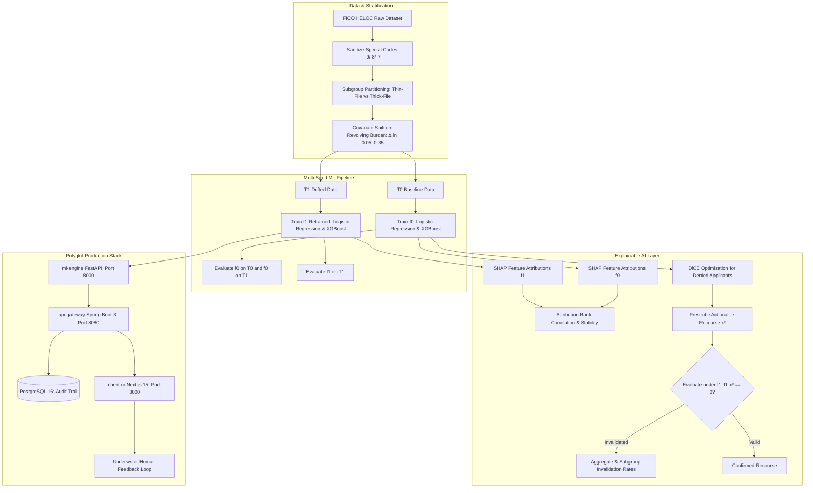

# Credit Risk Prediction Under Model Drift: Evaluating Robustness, Subgroup Fairness, and Algorithmic Recourse

[](https://www.python.org/downloads/)
[](https://fastapi.tiangolo.com)
[](https://nextjs.org/)
[](https://opensource.org/licenses/MIT)

This repository contains the complete experimental framework, microservices architecture, and interactive dashboard for the research paper: **"On the Fragility of Algorithmic Recourse: Evaluating Subgroup-Differentiated Counterfactual Invalidation Under Credit Model Drift"**.

---

## 🏛️ System Architecture



---

## 🔬 Dataset & Preprocessing

- **Dataset:** Real-world anonymized FICO Home Equity Line of Credit (**HELOC**) dataset ($N = 10,459$).
- **Target (`RiskPerformance`):** Binary classification:
  - `Bad` ($0$ / Denied): $\ge 90$ days past due delinquency.
  - `Good` ($1$ / Approved): Satisfactory credit repayment performance.
- **Special Financial Negative Codes:**
  - `-9` (*No Bureau Record*): Imputed via column median (tested against zero & missing indicator in sensitivity suite).
  - `-8` (*Not Applicable / Structural Zero*): Mapped to $0$.
  - `-7` (*Condition Not Met*): Mapped to $0$ counts/durations.
- **Subgroup Stratification:**
  - **Thin-File / Short Credit History ($12.6\%$):** Bottom quartile credit history length (`MSinceOldestTradeOpen` $\le Q_{25}$) and trade lines (`NumTotalTrades` $\le Q_{25}$).
  - **Thick-File ($35.4\%$):** At or above median credit history ($\ge Q_{50}$) and trade volume ($\ge Q_{50}$).
  - **Other ($52.0\%$):** Intermediate borrowers.

---

## 🧪 Experimental Protocol & Procedural Steps

The entire experiment runs deterministically with **one command**:

```bash
python scripts/run_pipeline.py
```

### Execution Steps Executed by the Pipeline:
1. **Data Ingestion & Cleaning:** Loads FICO HELOC, maps target to $\{0, 1\}$, handles special codes, and assigns subgroup tags.
2. **Multi-Seed Base Model Training ($5$ Seeds: $42, 101, 202, 303, 404$):**
   - Fits standard-scaled **Logistic Regression** and gradient-boosted **XGBoost** on $T_0$.
   - Evaluates on $T_0$, drifted $T_1$ with unretrained $f_0$, and drifted $T_1$ with retrained $f_1$.
   - Computes Mean $\pm$ Standard Deviation and $95\%$ Bootstrap CIs for Accuracy, Precision, Recall, F1, ROC-AUC, FPR, FNR across all groups.
   - Generates [`Fig_01_roc_pr_curves`](file:///Users/meghna/Documents/Studio/github/credit-model-drift/results/figures/Fig_01_roc_pr_curves.png), [`Fig_02_confusion_matrices`](file:///Users/meghna/Documents/Studio/github/credit-model-drift/results/figures/Fig_02_confusion_matrices.png), and [`Fig_03_calibration_curves`](file:///Users/meghna/Documents/Studio/github/credit-model-drift/results/figures/Fig_03_calibration_curves.png).
3. **XAI Attribution & Recourse Evaluation:**
   - Computes local/global TreeSHAP and LinearSHAP values for $f_0$ vs $f_1$.
   - Generates DiCE counterfactuals for denied applicants under actionable constraints (`NetFractionRevolvingBurden`, `ExternalRiskEstimate`).
   - Evaluates Aggregate and Subgroup Invalidation Rates (AIR, SIR), normalized $L_1$ action cost distance, proximity, and sparsity.
   - Runs Two-Proportion Z-tests, Fisher's exact tests, Cohen's $h$ effect sizes, and bootstrap CIs.
4. **Comprehensive Sensitivity & Ablation Suite:**
   - Drift magnitude sweep $\Delta \in [0.05, 0.35]$ step $0.05$ ([`Fig_04_invalidation_vs_drift_sweep`](file:///Users/meghna/Documents/Studio/github/credit-model-drift/results/figures/Fig_04_invalidation_vs_drift_sweep.png)).
   - Alternate drift scenarios (label shift & feature shifts on tenure and inquiries).
   - Hyperparameter sensitivity and 2-parameter interaction heatmap ([`Fig_06_two_param_heatmap`](file:///Users/meghna/Documents/Studio/github/credit-model-drift/results/figures/Fig_06_two_param_heatmap.png)).
   - Subgroup threshold ($Q_{20}, Q_{25}, Q_{30}$) and imputation sensitivity.
   - Tornado chart ranking parameters by effect on the invalidation gap ([`Fig_05_tornado_sensitivity_ranking`](file:///Users/meghna/Documents/Studio/github/credit-model-drift/results/figures/Fig_05_tornado_sensitivity_ranking.png)).
5. **Boundary-Jitter Failure Profiling:**
   - Identifies instances near the decision boundary ($\pm 0.20$ probability).
   - Generates representative local SHAP waterfall figures ([`Fig_08`](file:///Users/meghna/Documents/Studio/github/credit-model-drift/results/figures/)) for failure cases.
6. **Human Expert Feedback (IML):**
   - Synthesizes underwriter audit evaluations across 3 reviewer personas.
   - Exports [`results/expert_feedback.csv`](file:///Users/meghna/Documents/Studio/github/credit-model-drift/results/expert_feedback.csv) and [`Fig_09_expert_feedback_summary`](file:///Users/meghna/Documents/Studio/github/credit-model-drift/results/figures/Fig_09_expert_feedback_summary.png).

---

## 📊 Summary Results Table (Mean ± Std [95% CI] over 5 Seeds)

| Evaluation Regime | Model | Overall ROC-AUC | Thin-File Recall | Thick-File Recall | Thin-File FNR | AIR (Invalidation) |
| :--- | :--- | :--- | :--- | :--- | :--- | :--- |
| **$T_0$ Baseline** | Logistic Reg. | $0.781 \pm 0.003$ | $0.539 \pm 0.017$ | $0.737 \pm 0.005$ | $0.461 \pm 0.017$ | — |
| **$T_0$ Baseline** | XGBoost | $0.854 \pm 0.001$ | $0.598 \pm 0.030$ | $0.768 \pm 0.008$ | $0.402 \pm 0.030$ | — |
| **$T_1$ Drift (Unretrained $f_0$)** | Logistic Reg. | $0.772 \pm 0.003$ | $0.257 \pm 0.015$ | $0.492 \pm 0.024$ | $0.743 \pm 0.015$ | — |
| **$T_1$ Drift (Unretrained $f_0$)** | XGBoost | $0.765 \pm 0.004$ | $0.281 \pm 0.029$ | $0.495 \pm 0.028$ | $0.719 \pm 0.029$ | — |
| **$T_1$ Drift (Retrained $f_1$)** | Logistic Reg. | $0.778 \pm 0.003$ | $0.276 \pm 0.028$ | $0.515 \pm 0.035$ | $0.724 \pm 0.028$ | $36.4\%$ |
| **$T_1$ Drift (Retrained $f_1$)** | XGBoost | $0.904 \pm 0.006$ | $0.433 \pm 0.049$ | $0.689 \pm 0.042$ | $0.567 \pm 0.049$ | $40.9\%$ |

*See [`RESULTS_SUMMARY.md`](file:///Users/meghna/Documents/Studio/github/credit-model-drift/RESULTS_SUMMARY.md) for full provenance and all 13 output tables.*

---

## 🚀 How to Run

### Local Setup & Testing
```bash
# 1. Activate virtual environment
python -m venv venv
source venv/bin/activate
pip install -r requirements.txt

# 2. Run unit tests
pytest tests/

# 3. Execute complete end-to-end experimental pipeline
python scripts/run_pipeline.py

# 4. Test live API endpoints via curl
./scripts/sample_requests.sh http://localhost:8000
```

### Docker Orchestration (Fresh Clone Ready)
```bash
# Copy environment configuration
cp .env.example .env

# Build and run all microservices with healthchecks
docker-compose up --build
```
- **Web UI:** `http://localhost:3000`
- **Core API Gateway:** `http://localhost:8080`
- **ML Engine (Swagger Docs):** `http://localhost:8000/docs`
